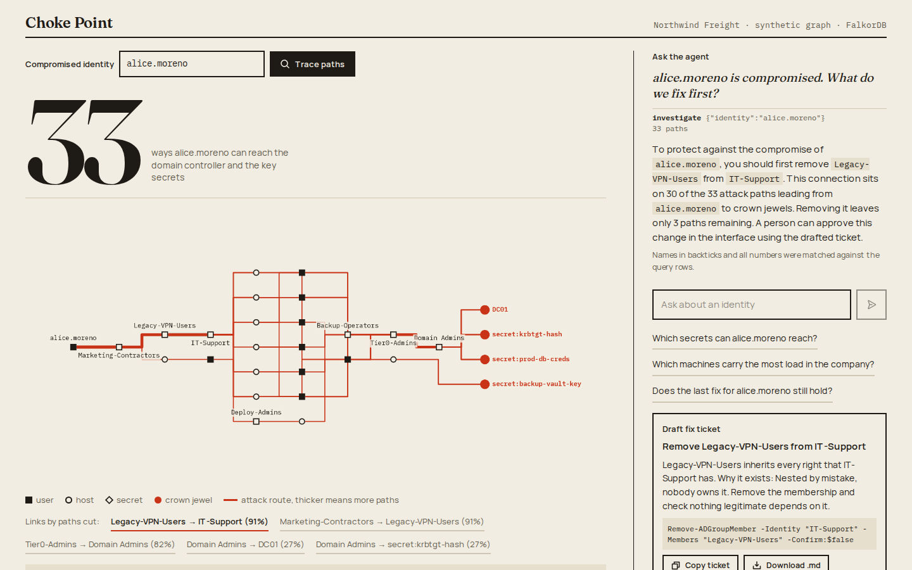
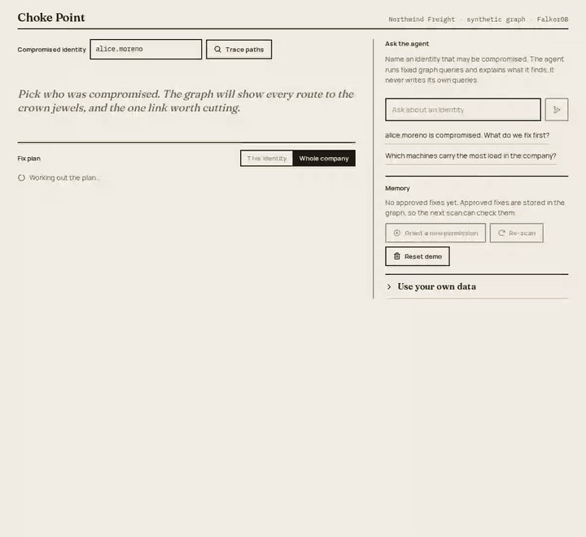
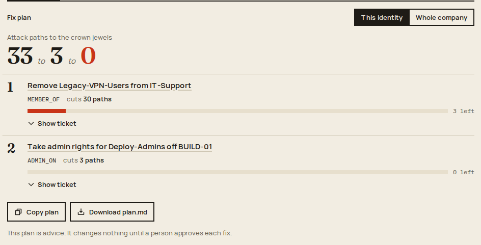
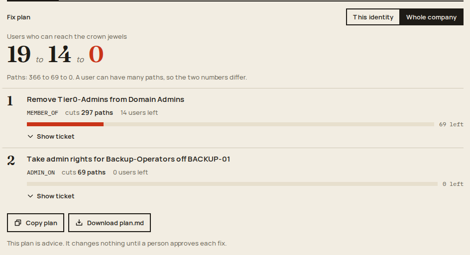
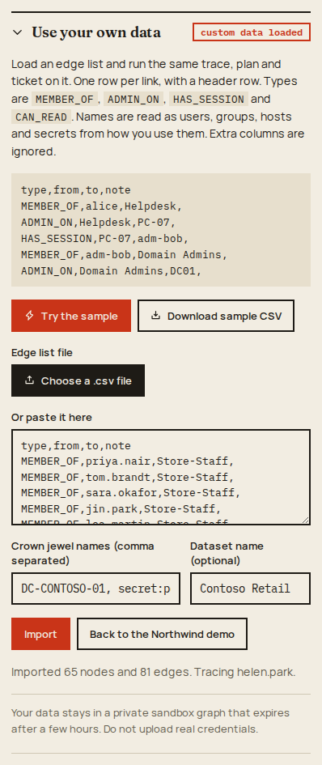
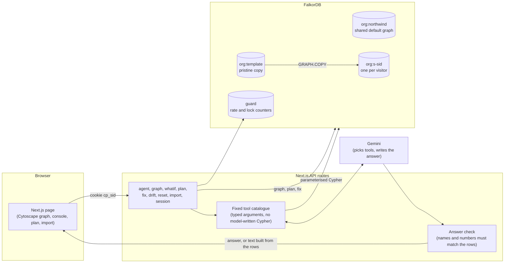

# Choke Point

[](https://github.com/Sarcastic-Soul/choke-point/actions/workflows/ci.yml)
[**Live demo: choke-point.vercel.app**](https://choke-point.vercel.app)

An agent that answers one question for a security team: **if this account is compromised, which single change cuts the most attack paths?**



It reads a company graph in FalkorDB and finds every route from the compromised identity to the crown jewels (the domain controller and three key secrets). It ranks the links by how many routes pass through them, shows what happens if the top link is cut, and drafts a fix ticket. A person approves the fix. The approved fix is stored in the graph, so the next scan can check that it still holds.

On the demo data, `alice.moreno` (a marketing contractor) has **33 attack paths**. One group nested inside another by mistake, `Legacy-VPN-Users` inside `IT-Support`, sits on 30 of them. Cut that one link and **3 paths** are left. A second fix takes them to **0**.



Built for the WeMakeDevs x FalkorDB Graph Hacks hackathon. Track 1: Agents That Act on Connected Data. It also touches Track 2 (Agent Memory and Coordination) through the remediation memory.

## What it does

- **Trace paths.** Pick a compromised user, group or host. See every route to the crown jewels, with thicker lines where more routes share a link.
- **Preview the cut.** Take out one link and watch the count drop. Nothing is written to the graph.
- **Fix plan.** The best few fixes in order, each one cutting the most paths still left. It works for one identity or for the whole company. Each step comes with a draft ticket.
- **Ask the agent.** Plain questions in, a fixed set of graph tools behind it, and an answer that is checked against the query rows.
- **Approve and remember.** Only a person can approve. The fix is saved in the graph, and a re-scan shows whether new permissions have opened new routes.
- **Your own sandbox.** Every visitor gets a private copy of the demo graph, so changes do not leak between people.
- **Your own data.** Import a CSV edge list into your sandbox and run the same trace, plan and ticket on it.
- **Export and share.** Copy or download a ticket or a plan as Markdown, and share a link to what is on screen.

### Fix plan



The plan has two views. **This identity** plans for the person you are tracing. **Whole company** plans for every user at once, and counts users as well as paths.



On the demo data the company plan starts at 366 paths across 19 of 313 users, and two steps take it to 0.

How the plan is worked out:

1. Count the live paths to the crown jewels.
2. Rank the links by how many of those paths go through them. Pick the top one.
3. Leave that link out and count again. The drop is the number of paths that link was on.
4. Repeat on what is left, up to 3 steps in the page (the API and the agent allow up to 5).

The plan is **greedy**: each step is the best link right now, so it is not proven to be the smallest possible set of cuts. The number for each step is **exact**, because removing a link removes exactly the paths that go through it. The graph is never changed by planning. A plan is advice, and each fix still needs its own approval.

### Bring your own data



Open **Use your own data** in the side panel. You can paste an edge list, choose a `.csv` file, or press **Try the sample** (a second synthetic company, Contoso Retail; **Download sample CSV** gives you the file).

```csv
type,from,to,note
MEMBER_OF,alice,Helpdesk,
ADMIN_ON,Helpdesk,PC-07,
HAS_SESSION,PC-07,adm-bob,
MEMBER_OF,adm-bob,Domain Admins,
ADMIN_ON,Domain Admins,DC01,
```

- The header row is required. The columns are `type,from,to,note`. Extra columns are ignored.
- `type` is one of `MEMBER_OF`, `ADMIN_ON`, `HAS_SESSION`, `CAN_READ`.
- There is no kind column. Whether a name is a user, group, host or secret is worked out from how it is used. For example, the target of `ADMIN_ON` is a host and the target of `CAN_READ` is a secret.
- You name the crown jewels yourself (comma separated). They must appear in the file.
- Limits: 1 MB, 5,000 edges, 2,000 names, names up to 80 characters, notes up to 200, up to 50 crown jewels, 5 imports per minute. A bad file is refused with a list of the first problems, and nothing is imported.
- Import only works in your own sandbox, never in the shared graph. **Back to the Northwind demo** brings the demo back. Do not upload real credentials.

### Export and share links

- **Copy ticket** and **Download .md** on a draft ticket, and **Copy plan** and **Download plan.md** on a plan, give Markdown you can paste into an issue tracker.
- **Copy link** gives a URL like `/?from=alice.moreno&edge=<edge id>`. It holds only the identity and the focused link. It opens the same view for anyone on the demo data. For imported data it only works in the sandbox that holds that data.

## Why a graph

"Who can reach what" is a path question, not a table question. Group nesting, admin rights and cached logins chain together, and the dangerous routes are five or more hops long. A graph database follows those hops in one query. The count of paths through each link, which is what makes a choke point, falls out of the same traversal.

## How it works



1. **Sandbox.** The first page load sets a cookie, `cp_sid`. The first API call after that copies `org:template` into a private graph, `org:s-<sid>`, with `GRAPH.COPY`. The copy expires after a few hours without use (3 hours by default) and the cookie is renewed with every page load. New copies are capped per hour. Past the cap, or if a sandbox cannot be made, the visitor falls back to the shared default graph, `org:northwind`. If the database is emptied, the default graph and the template build themselves again.
2. **Trace.** The graph route matches every path with a variable-length pattern, up to 10 hops, over live links only. The browser then repeats the path counting on the returned subgraph, so previewing a cut is instant.
3. **Plan.** The plan route works as described above. Steps and tickets come from the same counts the other queries use.
4. **Agent.** The model picks from a fixed set of tools and fills typed arguments. Each tool runs a fixed, parameterised query. The reply is then checked (see below).
5. **Approve.** Only the **Approve** button calls `/api/fix`. It marks the edge as removed and stores a `(:Fix)` node in the graph.

## Agent tools

The catalogue is in `src/lib/agent/tools.ts`. There are twelve tools:

| Tool | What it does |
| --- | --- |
| `find_entity` | Looks a name up in the graph, with close matches if it is not found. |
| `investigate` | The full first answer for one identity: path count, shortest routes, best fix, effect of the cut, draft ticket. |
| `attack_paths` | Lists the routes from an identity to the crown jewels. |
| `choke_points` | Ranks the links by how many of the identity's paths use them. |
| `what_if_remove` | Counts paths again with one link removed. |
| `exposed_secrets` | Lists the secrets an identity can reach, with hop counts. |
| `load_bearing` | Ranks the most load-bearing nodes in the company by betweenness. |
| `draft_fix` | Writes a fix ticket for one link. Draft only. |
| `fix_plan` | The greedy plan for one identity, or for the whole company if no identity is given. Advice only. |
| `company_exposure` | How many users can reach a crown jewel, and the links on the most paths across all of them. |
| `recall_fixes` | Lists fixes approved earlier, newest first. |
| `new_paths_since_last_fix` | Finds paths that use a link added after the latest approved fix. |

## How the agent is kept honest

- The model never writes Cypher. It picks a tool and fills typed arguments.
- Every tool checks the name against the graph itself. A name that is not in the graph returns `unknown_entity` with close matches, and the answer is fixed: that name is not in the graph, no query was run.
- An answer check (`src/lib/agent/answer.ts`): every name in backticks and every number in the reply must appear in the query rows. If the check fails, the reply is replaced by text built from the rows, and the interface says so.
- Zero paths is never reported as "safe". It is reported as "none is modeled".
- Fix tickets and plans are written from templates, not by the model. The agent can draft a fix but cannot apply one.
- If the model is rate limited or down, or the daily budget is used up, the agent falls back to offline mode: it runs the same graph queries and writes the answer from the result rows.

## What FalkorDB does here

- **Cypher variable-length path matching.** Every attack path comes from one match like `(s)-[:MEMBER_OF|ADMIN_ON|HAS_SESSION|CAN_READ*1..10]->(t {crown: true})`. Choke points, the cut preview, the plan and the company view are all counts over that same match.
- **`algo.betweenness`.** The load-bearing ranking over the whole company.
- **`GRAPH.COPY`.** A visitor's sandbox is a copy of the pristine template graph, made inside the database.
- **Parameterised queries.** Every value goes in as a parameter. Names from a visitor's CSV are never put into query text.
- **One graph per tenant.** `org:northwind` (shared default), `org:template`, `org:s-<sid>` (sandboxes) and `guard` (counters for rate limits and locks). A graph is a Redis key, so `EXPIRE` gives sandboxes their time limit.
- **Memory nodes.** Approved fixes are `(:Fix)` nodes linked `ABOUT` to both ends of the cut edge and `FOUND_FROM` to the identity that was investigated. A re-scan looks for paths that use an edge with `addedAt` later than the last fix.
- A 5 second query timeout is set on every read query.

## Run it

You need [bun](https://bun.sh), Docker, and optionally a free Gemini API key.

```bash
docker compose up -d            # FalkorDB on :6379, FalkorDB Browser on :3000
cp .env.example .env.local      # add GOOGLE_GENERATIVE_AI_API_KEY if you have one
bun install
bun run seed                    # builds the graph (671 nodes, 1,160 edges). A non-local database needs --yes
bun run dev                     # http://localhost:3001
bun test                        # needs the database to be running
```

Without a Gemini key the agent still works in offline mode.

Settings (`.env.local`, same names on Vercel). `.env.example` is the reference.

| Name | Meaning |
| --- | --- |
| `FALKORDB_URL` | `falkor://localhost:6379` locally, `falkor://<host>:<port>` for FalkorDB Cloud (use `falkors://` if your plan has TLS, because the password is otherwise sent in clear text) |
| `FALKORDB_USERNAME`, `FALKORDB_PASSWORD` | empty locally |
| `GOOGLE_GENERATIVE_AI_API_KEY` | optional, from Google AI Studio |
| `AGENT_MODEL` | model id, for example `gemini-3.5-flash-lite` (default `gemini-2.5-flash-lite`) |
| `AGENT_DAILY_LIMIT` | model calls per day on a public deployment before the agent switches to offline mode (default 400) |
| `SANDBOX_TTL_SECONDS` | how long a visitor's private graph lives without use (default 10800, three hours) |
| `SANDBOX_HOURLY_LIMIT` | new private graphs per hour. Past it, new visitors share the default graph (default 300) |

### Tests and CI

`bun test` covers the generator, queries, fixes, plans, import, export, share links, sandboxes, the rate guard and the answer check. It needs the database. GitHub Actions (`.github/workflows/ci.yml`) runs on every push and pull request to `main`, with a FalkorDB service container: `tsc --noEmit`, lint, `bun test`, then `next build`.

## Graph data model

Edges point the way an attacker moves.

```
(User)  -[:MEMBER_OF]->   (Group)     a user, or a group nested in a group
(Group) -[:ADMIN_ON]->    (Host)      the group has admin rights on a machine
(Host)  -[:HAS_SESSION]-> (User)      a user is logged in there, so their credentials are cached
(Group|Host) -[:CAN_READ]-> (Secret)  can read a key or password
```

- Every node has the label `:Entity` plus its kind (`User`, `Group`, `Host`, `Secret`). Properties: `name`, `crown` (true for crown jewels), `dept`, `note`.
- Every edge has `id`, `weight`, `removed`, `addedAt` and `note`. Approving a fix sets `removed = true`. The path queries skip removed edges. (`algo.betweenness` takes only labels and relationship types, so the company-wide load ranking still counts them.)
- The demo data is synthetic ("Northwind Freight"), made by a seeded generator in `src/lib/data/generate.ts`, so every run is the same. It has about 290 staff in 8 departments, contractors, IT and help desk groups, admin accounts, service accounts, jump hosts, dev servers, and a planted mistake: a 2021 VPN migration nested `Legacy-VPN-Users` into `IT-Support`.

## Queries used

All Cypher is in `src/lib/graph/` (`queries.ts`, `plan.ts`, `fixes.ts`).

- **All attack paths**: `MATCH p=(s:Entity {name: $from})-[:MEMBER_OF|ADMIN_ON|HAS_SESSION|CAN_READ*1..10]->(t:Entity {crown: true}) WHERE ALL(r IN relationships(p) WHERE r.removed = false)`
- **Choke points**: the same match, then `UNWIND relationships(p) AS r` and `count(*)` per edge id, ordered by count. Edges that start at the compromised identity are skipped, because "remove the user from their own group" is not a useful answer.
- **What if we cut it**: the same count again with one edge id left out. No graph copy is made.
- **Plan and company view**: the same match, started from one name or from every `User`, with the already-chosen edge ids left out.
- **Load-bearing nodes**: `CALL algo.betweenness(...)` over the whole company.
- **Memory**: `(:Fix)` nodes written on approval.
- The browser repeats the path counting on the returned subgraph, so the preview of a cut is instant. When the graph has no cycle it uses a fast count; when it has one (imported group loops, for example) it walks every route up to 10 links, the same way the database counts, and stops at 200,000 steps. A test compares the browser totals with the database for the demo data and for the sample import, including the loop.

## Layout

```
src/lib/data/       synthetic company generator
src/lib/graph/      FalkorDB client, seed, queries, plan, fixes and memory, CSV import
src/lib/agent/      tools, answer check, agent loop
src/lib/tenant.ts   per-visitor sandbox graphs
src/lib/view.ts     path counting and layout for the graph view
src/app/api/        agent (streaming), graph, whatif, plan, fix, drift, reset, import, session
src/components/     the interface
tests/              bun tests
docs/               screenshots for this README
```

## Limits and honest notes

- The data is synthetic. The CSV import takes any edge list in the format above, but there is no importer for real directory exports such as BloodHound.
- Paths are counted up to 10 hops, which covers the longest planted route (9 hops). A very dense imported graph can have too many routes to count inside the 5 second query limit; the page then shows an error instead of a number.
- Dense imported graphs can have so many routes that a query runs past the 5 second limit. The page and the agent then show a "took too long" message instead of a result.
- A plan is advice only. Approval is per identity: approving a fix in the plan does not approve the others.
- A "path" here is a route through permissions. It is not proof that an attacker could use it.
- The answer check matches names in backticks and every number against the query rows. It does not catch a wrong claim built from correct names and numbers.
- The fix text uses PowerShell-style commands as examples, and nothing is run.
- The FalkorDB Cloud user cannot run Redis `SET` or `EVAL`, so the lock that builds the template graph is a counter in the `guard` graph, not a Redis lock.
- The template graph is never refreshed. After you change the seed data, delete `org:template` so it is built again (sandboxes made earlier keep their old copy until they expire).
- Free-tier FalkorDB Cloud can be restarted and lose its data. The app rebuilds the demo graph and the template when that happens, and sandboxes that were lost are copied again on the next visit.
- On a public deployment, POST routes only accept same-origin calls, Reset is rate limited, imports are limited to 5 a minute per sandbox, and the model has a daily budget (past it, answers come from the graph alone).

## AI use

This project was built with the help of AI coding assistants (Claude Code from Anthropic). The author reviewed the code and stands behind it. The agent inside the app uses Google Gemini through the Vercel AI SDK to choose tools and explain results.
